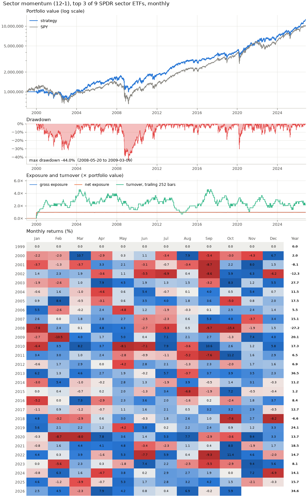

# Tradewind

An Apache 2.0 backtesting engine compatible with the backtrader API, built for depth and speed.

```bash
pip install tradewind
```

Documentation: [docs/](docs/README.md) — [getting started](docs/getting-started.md), [how a backtest runs](docs/concepts.md), [migrating from backtrader](docs/migrating-from-backtrader.md), [coming from QuantConnect Lean](docs/coming-from-lean.md). Design documents: [spec/](spec/README.md).

Optional extras: `pip install 'tradewind[plot]'` for the native plots (matplotlib:
`strategy.analyzers.performance.plot()`, see [docs/plots.md](docs/plots.md));
`pip install 'tradewind[tearsheets]'` for Quantopian's tear sheets through
[pyfolio-reloaded](https://github.com/stefan-jansen/pyfolio-reloaded),
[alphalens-reloaded](https://github.com/stefan-jansen/alphalens-reloaded) and
[empyrical-reloaded](https://github.com/stefan-jansen/empyrical-reloaded) (Apache 2.0, not
distributed with Tradewind, see `NOTICE`; Python 3.11 or later).



*Sector momentum (12-1), top 3 of the 9 SPDR sector ETFs, monthly; daily bars 1999-01-04 to
2026-10-30 (first trade 2000-01-04); 5 bp commission per fill, fills at the next open;
Papers With Backtest ETF prices (total return). CAGR 9.5 % against 8.6 % for SPY, Sharpe 0.61
against 0.53, max drawdown 44.0 % against 55.2 %. Code and two more examples:
[docs/real-data-examples.md](docs/real-data-examples.md).*

Releases: a `vX.Y.Z` tag matching the version in `pyproject.toml` builds, checks and publishes the package to PyPI through trusted publishing (`.github/workflows/release.yml`); nothing is published by hand.

Maintained by [Papers With Backtest](https://paperswithbacktest.com).
