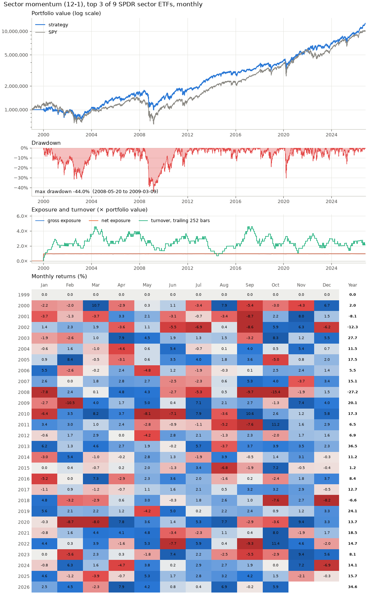

# Tradewind documentation

Tradewind is a backtesting engine for Python, under the Apache 2.0 licence, that runs
strategies written against the backtrader API. It is event-driven (one `next()` per bar,
the same code path a live run will take), vectorised across securities inside each bar,
and has two runtime dependencies: numpy and pandas.

```bash
pip install tradewind
```

```python
import tradewind as tw          # or, in an existing project: import tradewind as bt
```

## Status

Version 0.0.2, November 2026. The compatible surface is complete for the strategies it was
built against (a corpus of about 4 200 published strategies) and is checked against
backtrader's own results, bar by bar:

| what | where it stands |
|---|---|
| Strategies, data feeds, orders (market, close, limit, stop), positions, notifications, timers | done, identical NAVs to backtrader on ~1 000 corpus strategies and on 33 synthetic probes |
| Indicators used by the corpus (SMA, EMA, Highest, Lowest, ROC, ATR, RSI, MACD, CrossOver, StdDev) and custom indicators | done, bit for bit |
| Analyzers: `TradeAnalyzer`, `DrawDown`, `SharpeRatio`, `TimeReturn`; `Performance` (Sharpe as the catalogue computes it, Sortino, PSR, alpha/beta, drawdown, exposure, turnover, capacity) | done |
| Typed API (`tw.TypedStrategy`, dataclass parameters, typed events and orders, `py.typed`) on the same engine | done ([Typed API](typed-api.md)) |
| Pluggable reality models (fees, fills, slippage, buying power, settlement, shorting, margin interest, corporate actions), per security | interfaces done; the default set reproduces backtrader |
| Exchange calendars (NYSE, Nasdaq, CME, crypto), minute clock, timers in exchange time | done, opt-in; the default clock stays backtrader's |
| Run fingerprint (data, code, parameters, seed) | done: `engine.fingerprint` |
| Minute bars: consolidation to N minutes / hours / sessions, a bounded loader, splits on unadjusted prices | done ([Intraday data](intraday.md)) |
| Listed options: contracts with their multiplier, chains, Black-Scholes-Merton and implied volatility, exercise and assignment at expiry | done on daily option tables ([Options](options.md)) |
| Realistic models: spread per security and year, volume-capped fills, Reg T margin and margin calls, borrow fees, T+1/T+2 settlement, interest | done, opt-in ([Realistic models and currencies](realistic-models.md)) |
| Several currencies: cash per currency, conversion from FX feeds, value in the account currency | done, opt-in |
| Point-in-time universes (members entering and leaving), splits, dividends, delistings and ticker changes from symbol tables, raw or adjusted prices | done, opt-in ([Universes and corporate actions](universe-and-corporate-actions.md)) |
| Futures | interfaces in place, implementations planned |
| Live trading on Interactive Brokers (paper first): `tradewind.live`, `pip install 'tradewind[ibkr]'` | preview ([Live trading](live-trading.md)) |
| Daily paper run of a meta-portfolio: signals after the close, a capped and rounded book, proposed orders, live against backtest: `python -m tradewind.live.daily` | preview, paper accounts only ([the daily paper run](live-paper.md)) |
| Plots (equity against a benchmark, drawdown, monthly returns, exposure and turnover) and a bridge to pyfolio and alphalens tear sheets | done, opt-in: `tradewind[plot]`, `tradewind[tearsheets]` ([Plots and tear sheets](plots.md)) |
| backtrader's resampling and replay, its own `cerebro.plot()`, `optstrategy` | not available yet |

Speed: the engine itself costs 0.2 to 1 µs per security and bar on a 2 000-security
universe (`tools/bench_engine.py`); on the corpus the median strategy runs about 2.3 times
faster than on backtrader, data loading included. See [Performance](performance.md).

## What a run looks like



--8<-- "pwb/momentum_sectors_metrics.md"

`strategy.analyzers.performance.plot()` draws it ([Plots and tear sheets](plots.md)); the
code is on [Examples on real data](real-data-examples.md).

## Contents

1. [Getting started](getting-started.md): install, a first backtest, reading the result.
2. [How a backtest runs](concepts.md): the clock, the sixteen phases of a bar, lines and
   `ago` indexing, when an order fills.
3. [Strategies](strategies.md): parameters, data access, orders, positions, notifications,
   timers.
4. [Data feeds](data-feeds.md): `PandasData`, column mapping, several instruments, late
   listings.
5. [Orders and the broker](orders-and-broker.md): order types and states, cash checks,
   commissions, slippage, leverage, per-security models.
6. [Indicators](indicators.md): the built-in ones, writing your own, line arithmetic.
7. [Analyzers](analyzers.md): drawdown, Sharpe ratio, trade statistics, period returns, and
   the full statistics of a run (`Performance`).
8. [Migrating from backtrader](migrating-from-backtrader.md): what changes (an import),
   what is not supported, and the behaviours worth knowing.
9. [Coming from QuantConnect Lean](coming-from-lean.md): a concept-by-concept map.
10. [Performance](performance.md): what costs what, and how to write fast strategies.
11. [Intraday data](intraday.md): minute bars, consolidated bars, loading a window, splits.
12. [Options](options.md): contracts, chains, Greeks and implied volatility, expiry.
13. [Typed API](typed-api.md): strategies as annotated classes, parameters in a dataclass,
    typed events and orders, on the same engine.
14. [Realistic models and currencies](realistic-models.md): measured spreads, partial fills,
    margin, borrow fees, settlement, several currencies.
15. [Universes and corporate actions](universe-and-corporate-actions.md): point-in-time
    membership, splits, dividends, delistings, ticker changes, raw or adjusted prices.

16. [Calendars and clock](calendars-and-clock.md): exchange calendars, a clock in exchange
    hours, timers in the exchange's time.
17. [Live trading (IB)](live-trading.md): the same strategy on an Interactive Brokers paper
    account, journal and replay, guards.
    [The daily paper run](live-paper.md): several strategies in one paper account, orders
    proposed every evening, the account tracked against its backtest.
18. [Reproducibility](reproducibility.md): the run fingerprint, what it guarantees and what
    it does not.
19. [Tradewind vs Lean](tradewind-vs-lean.md): where Tradewind is at level, ahead and
    behind, dated.
20. [Plots and tear sheets](plots.md): equity, drawdown, monthly returns, exposure;
    pyfolio and alphalens tear sheets.
21. [Examples on real data](real-data-examples.md): three ETF strategies on Papers With
    Backtest data, with their figures.
22. [API reference](reference/index.md): generated from the docstrings.

The [runnable examples](examples.md) run as they are, on synthetic data: `cd docs/examples &&
python 01_sma_crossover.py`. [Examples from the catalogue](catalogue-examples.md) points to
strategies from research papers, implemented and backtested on real data.

The design documents behind the engine are in [`spec/`](https://github.com/paperswithbacktest/tradewind/tree/main/spec): scope, the behaviours
kept from backtrader and those to be corrected, the oracle, and the interfaces.
