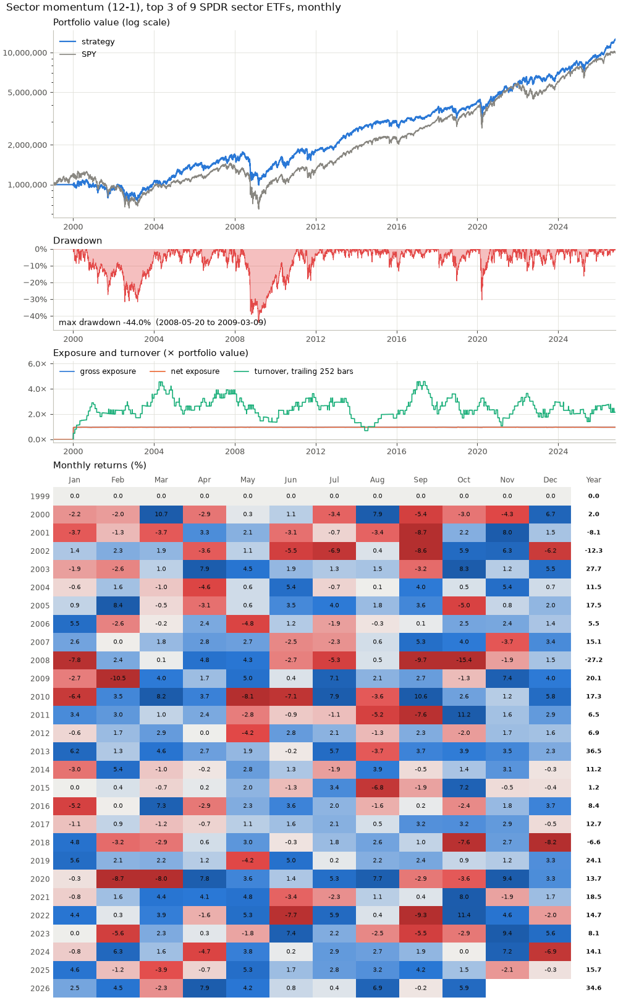
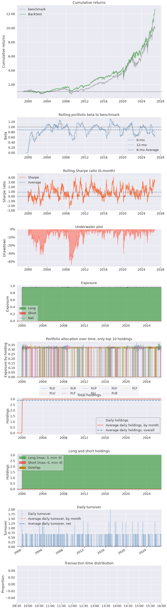

# Plots and tear sheets

A backtest's figures come from the [`Performance`](analyzers.md#performance) analyzer: it
records the portfolio value, the benchmark, the exposures, the positions and the fills of
every bar, and draws them with matplotlib, an optional dependency imported only when a plot
is drawn.

```bash
pip install 'tradewind[plot]'          # matplotlib
pip install 'tradewind[tearsheets]'    # also pyfolio-reloaded, alphalens-reloaded, empyrical-reloaded
```

## One figure

```python
engine.addanalyzer(tw.analyzers.Performance, _name="performance", benchmark="SPY")
strategy = engine.run()[0]
fig = strategy.analyzers.performance.plot(title="Sector momentum")
fig.savefig("run.png", dpi=100)
```

`plot()` returns a matplotlib `Figure` with four panels:

1. **Portfolio value**, on a log scale (`log=False` for a linear one), against the
   benchmark's closes rebased to the same starting value (the feed named by the analyzer's
   `benchmark` parameter, or any series passed as `benchmark=`).
2. **Drawdown** from the running peak, the "underwater" curve, with the deepest drawdown
   written on the panel: its depth is `tw.metrics.max_drawdown(values).depth`, the
   `max_drawdown` of the report, and its dates are those of the peak and the trough.
3. **Exposure and turnover**, in multiples of the portfolio value: gross (Σ|position
   value|), net (Σ position value) and the turnover over a trailing year (traded value /
   (2 × portfolio value), summed over `periods_per_year` bars), all on one axis.
4. **Monthly returns**, years × months, each cell written in percent, with the calendar
   year's return in the last column: the table `tw.plots.monthly_returns(...)` returns.
   A month is its last value over the last value of the month before; the first month
   starts from the first value of the run.



--8<-- "pwb/momentum_sectors_metrics.md"

The code of this run and two more are on [Examples on real data](real-data-examples.md).

## One panel at a time

Each panel is a function of `tradewind.plots` that draws on the axes it is given (a new
figure when `ax` is None) and returns them, so the panels go into your own layouts:

```python
import matplotlib.pyplot as plt
import tradewind as tw

perf = strategy.analyzers.performance
fig, (top, bottom) = plt.subplots(2, 1, figsize=(9, 6), sharex=True)
tw.plots.plot_equity(perf, ax=top, log=False)
tw.plots.plot_drawdown(perf, ax=bottom)
```

| function | draws | source |
|---|---|---|
| `plot(source, benchmark=None, log=True, title=None)` | the four panels, returns the `Figure` | analyzer, strategy or NAV series |
| `plot_equity(source, benchmark=None, log=True, ax=None)` | portfolio value against a benchmark | analyzer, strategy or NAV series |
| `plot_drawdown(source, ax=None)` | underwater curve and the deepest drawdown | analyzer, strategy or NAV series |
| `plot_monthly_returns(source, ax=None, decimals=1)` | years × months grid of returns | analyzer, strategy or NAV series |
| `plot_exposure(source, ax=None, window=None)` | gross and net exposure, trailing turnover | analyzer or strategy |
| `monthly_returns(source)`, `drawdown_series(source)` | the numbers behind the panels, as pandas objects | analyzer, strategy or NAV series |

`source` is the `Performance` analyzer, the strategy that carries one, or a `pandas.Series`
of portfolio values indexed by time (from another engine, say); exposure needs the
analyzer.

## The run as pandas objects

The same analyzer gives the run as pandas objects, for your own plots and statistics:

| attribute | what |
|---|---|
| `perf.nav` | the portfolio value at every bar (`Series`) |
| `perf.returns` | its simple returns |
| `perf.benchmark_nav` | the benchmark's closes at every bar, or None |
| `perf.exposures` | `gross`, `net`, `long`, `short` and `traded`, fractions of the portfolio value (`DataFrame`) |
| `perf.positions` | the signed market value of every position at every bar, one column per symbol, plus `cash` |
| `perf.transactions` | one row per fill: `symbol`, `amount` (signed quantity), `price`, `commission`, indexed by the fill's time |

Positions plus cash equal the portfolio value at every bar (`tests/test_plots.py`).

## pyfolio and alphalens tear sheets

Quantopian's [pyfolio](https://github.com/stefan-jansen/pyfolio-reloaded) and
[alphalens](https://github.com/stefan-jansen/alphalens-reloaded) are maintained as the
"-reloaded" packages (Apache 2.0). Tradewind does not ship or copy them: the
`tearsheets` extra installs them (they need Python 3.11 or later), and
`tradewind.tearsheets` reshapes a run into the inputs their documented functions take.

```python
returns, positions, transactions = perf.to_pyfolio()   # daily, UTC, the shapes pyfolio documents
figures = perf.tearsheet("simple")                     # or "full"; returns the matplotlib figures

import pyfolio as pf                                   # or call pyfolio yourself
pf.create_returns_tear_sheet(returns, benchmark_rets=None)
```

`to_pyfolio()` gives daily returns (a run on minute bars is reduced to days), the
end-of-day market value of each position with a `cash` column, and one row per fill with
`amount`, `price` and `symbol`. `tearsheet()` passes the benchmark's daily returns when the
analyzer has a benchmark, and `estimate_intraday=False` since the positions are exact
end-of-day values; any other keyword goes to pyfolio (`live_start_date=...`,
`round_trips=True`...).

The simple tear sheet of the sector momentum run above (pyfolio-reloaded 0.10.2):

{ width="520" }

For a factor, `to_alphalens(factor, prices)` builds alphalens' factor data
(`get_clean_factor_and_forward_returns`): `factor` is a dates × assets table of the values
your strategy ranked on (or a series indexed by date and asset), `prices` a dates × assets
table or the strategy after its run (the closes of its feeds,
`tw.tearsheets.feed_closes(strategy)`). Tradewind has no factor object of its own, so the
factor is whatever table you record:

```python
import alphalens as al

closes = tw.tearsheets.feed_closes(strategy)
momentum = closes.shift(21) / closes.shift(252) - 1            # the 12-1 score of each day
factor_data = tw.tearsheets.to_alphalens(momentum.iloc[::21], strategy,
                                         quantiles=3, periods=(1, 5, 21))
al.tears.create_returns_tear_sheet(factor_data)
```

## Regenerating the figures of this documentation

The figures on these pages are real backtests on the Papers With Backtest datasets, made by
`docs/examples/make_figures.py` (about ten seconds and 0.6 GB of memory for the three
runs):

```bash
pip install -e '.[tearsheets]' pwb-toolbox
export HF_ACCESS_TOKEN=...       # or PWB_API_KEY: an access key to the datasets
python docs/examples/make_figures.py
```

It rewrites `docs/images/*.png` and the statistics included under each figure
(`docs/examples/pwb/*_metrics.md`). The documentation's CI does not run it, since the
repository holds no data access key: the images are committed.

??? example "make_figures.py"

    ```python
    --8<-- "make_figures.py"
    ```
