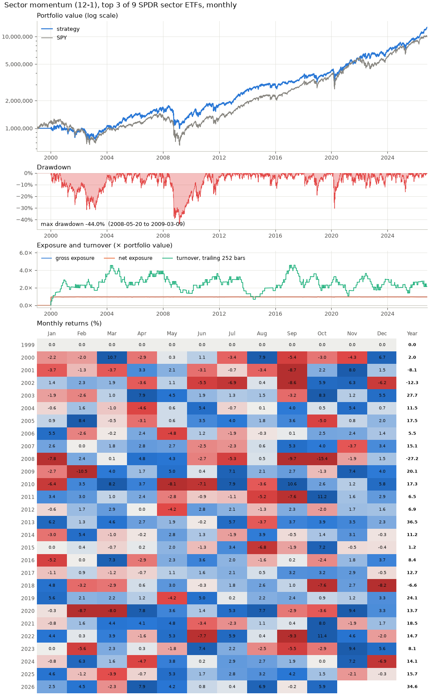
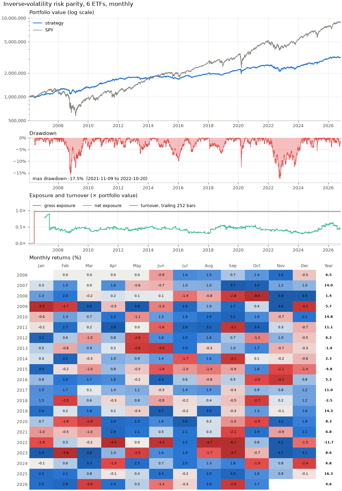
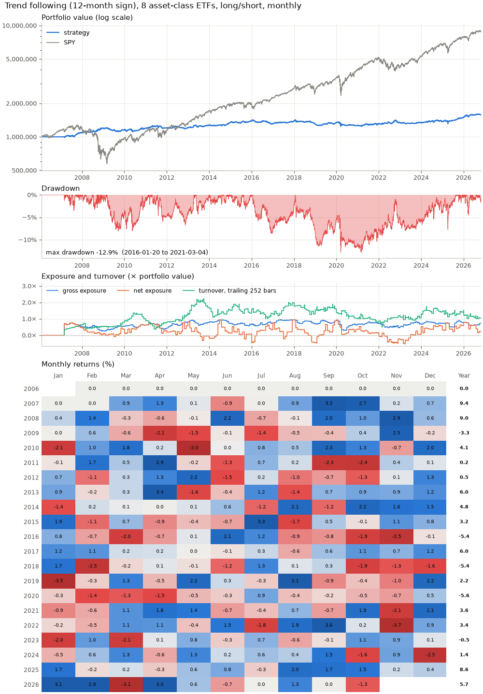

# Examples on real data

Three short strategies run on the [Papers With Backtest](https://paperswithbacktest.com)
datasets, ETFs only, each in a few seconds: a cross-sectional momentum rotation, a
multi-asset risk parity and a trend-following portfolio. The figures are
`Performance.plot()` (see [Plots and tear sheets](plots.md)) and the statistics under each
one are those of the same run, both written by `docs/examples/make_figures.py`.

They need the data: `pip install pwb-toolbox` and an access key to the datasets
(`PWB_API_KEY`, or `HF_ACCESS_TOKEN` for their Hugging Face copies). The loader is a few
lines:

??? example "pwb/_pwb_data.py"

    ```python
    --8<-- "pwb/_pwb_data.py"
    ```

Run one with `cd docs/examples/pwb && python momentum_sectors.py`. These are illustrations
of the engine, not recommendations: the rules are textbook ones, not tuned, and the costs
are a flat commission.

## Sector momentum

Each month, hold the three of the nine SPDR sector ETFs with the best return over the past
twelve months, skipping the most recent one, in equal weights.



--8<-- "pwb/momentum_sectors_metrics.md"

??? example "pwb/momentum_sectors.py"

    ```python
    --8<-- "pwb/momentum_sectors.py"
    ```

## Risk parity

Each month, weight six ETFs (US and developed equities, long and medium Treasuries, gold,
commodities) in inverse proportion to their volatility over the past 63 days.



--8<-- "pwb/risk_parity_metrics.md"

??? example "pwb/risk_parity.py"

    ```python
    --8<-- "pwb/risk_parity.py"
    ```

## Trend following

Each month, long each of eight asset-class ETFs whose past twelve-month return is
positive and short the others, each position sized to 10 % annual volatility and capped at
12 % of the portfolio. The exposure panel shows the gross and the net book apart.



--8<-- "pwb/trend_following_metrics.md"

??? example "pwb/trend_following.py"

    ```python
    --8<-- "pwb/trend_following.py"
    ```

## What is not here yet

An options example on real data (the [options](options.md) page has one on synthetic
data): the daily option tables are large enough that a short, light example needs a
bounded chain loader first.
